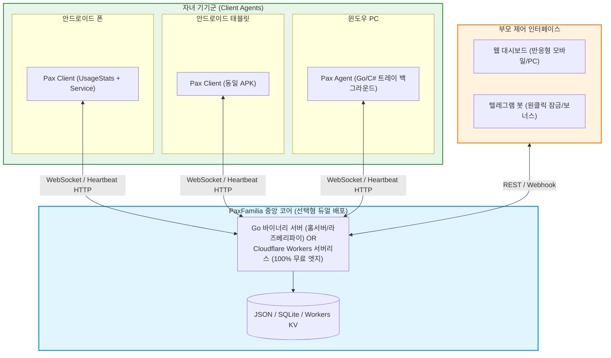

# 🏛️ PaxFamilia 시스템 아키텍처 (ARCHITECTURE)

PaxFamilia는 구글 Family Link와 마이크로소프트 Family Safety의 장점을 흡수하고, 두 서비스가 제공하지 못하는 **"크로스 플랫폼 통합 스크린타임 공유(Shared Quota)"**를 실현하기 위해 **경량 에이전트-중앙 서버 모델**을 채택합니다.

---

## 1. 전체 구조도

---

## 2. 왜 기존 Family Link / MS Safety와 연동(Scraping) 대신 자체 에이전트인가?

| 비교 항목 | Family Link / MS Safety 스크래핑 방식 | **PaxFamilia 자체 경량 에이전트 방식 (채택)** |
| :--- | :--- | :--- |
| **공식 API 여부** | ❌ 없음 (비공식 API 및 웹 크롤링에 의존) | ✅ 자체 REST/WebSocket 프로토콜 구축 |
| **계정 안전성** | ⚠️ 구글/MS 계정 2FA 및 봇 차단 위험 높음 | ✅ 개인 로컬/프라이빗 통신으로 계정 제재 위험 전무 |
| **동기화 속도** | ⏱️ 5분~15분 주기 폴링 (지연 발생) | ⚡ 10초~30초 실시간 Heartbeat 동기화 |
| **통합 잠금 제어** | ❌ 구글 설정과 MS 설정을 각각 변경해야 함 | ✅ 잔여 시간 0분 도달 시 즉각 화면 잠금 |
| **안정성** | ❌ 포털 UI/보안 정책 변경 시 수시로 고장 | ✅ OS 표준 API(UsageStats, LockWorkStation)로 영구 안정성 확보 |

> **💡 하이브리드 운영 전략:**
> - 유해 웹사이트 차단, 성인물 필터링, 스토어 결제 차단은 **Google Family Link**와 **MS Family Safety**에 맡겨둡니다.
> - **PaxFamilia**는 가장 핵심적인 **"시간 관리(총량제, 야간 차단, 원클릭 올스톱)"**를 전담합니다.

---

## 3. 핵심 동작 시나리오: "통합 공유 쿼터제 (Shared Quota)"

1. **초기 상태 (오전 0시 or 리셋 시간)**:
   - 자녀 A에게 오늘의 할당량 **120분 (2시간)** 지급.
2. **안드로이드 폰 사용 (14:00 ~ 14:40)**:
   - 폰 화면이 켜지고 앱이 활성화되면 Pax Android 에이전트가 30초마다 중앙 서버로 Heartbeat 전송.
   - 중앙 서버: 40분 차감 -> 남은 잔여 시간 **80분**.
3. **윈도우 PC 시작 (16:00)**:
   - 자녀가 PC를 켜고 로그인.
   - Pax Windows 에이전트가 서버에 접속하여 잔여 시간 조회: **"오늘 남은 시간은 80분입니다."** 트레이 알림 팝업.
4. **PC 사용 75분 경과 (잔여 5분)**:
   - PC 화면에 팝업: *"남은 시간이 5분입니다. 작업을 저장하세요."*
5. **잔여 시간 0분 도달**:
   - PC 에이전트가 Windows `LockWorkStation` API 호출하여 강제 잠금.
   - 동시에 안드로이드 폰과 태블릿에도 잔여 시간 0분이 전파되어 화면 오버레이 잠금 실행.
   - 부모 텔레그램/대시보드로 알림: *"자녀 A의 오늘 사용시간이 모두 소진되어 기기가 잠겼습니다."*
6. **부모의 보너스 승인 (선택 사항)**:
   - 부모가 텔레그램 메시지에서 `[+30분 연장]` 버튼 클릭.
   - 즉시 전 기기 잠금 해제 및 타이머 30분 재가동.

---

## 4. 클라이언트 플랫폼별 구현 기술 사양

### (1) 안드로이드 (스마트폰 & 태블릿 공용)
- **사용 권한**:
  - `PACKAGE_USAGE_STATS` (화면 켜짐 및 포그라운드 사용 시간 측정)
  - `SYSTEM_ALERT_WINDOW` (시간 초과 시 전면 안내 팝업 및 잠금 오버레이 표시)
  - `FOREGROUND_SERVICE` (안드로이드 OS에 의한 백그라운드 프로세스 강제 종료 방지)
  - `DEVICE_ADMIN` 또는 `ACCESSIBILITY_SERVICE` (임의 삭제 방지 및 앱 강제 종료)
- **최적화**:
  - 배터리 소모를 최소화하기 위해 화면이 꺼져 있을 때는 Heartbeat를 중지(Doze 모드 친화적).

### (2) 윈도우 PC
- **형태**: 백그라운드 Windows Service + 시스템 트레이 클라이언트 (Single Binary Executable)
- **언어/스택**: Go (또는 C# .NET Minimal / Rust)
- **감지 로직**:
  - `GetLastInputInfo` (마우스/키보드 미입력 시 유휴 상태 판별 -> 유휴 시 시간 차감 중지)
  - `GetForegroundWindow` (현재 사용 중인 프로그램 및 활성 창 감지)
- **잠금 로직**:
  - `user32.dll`의 `LockWorkStation()` 호출 (로그오프가 아닌 잠금 화면으로 전환하여 데이터 안전 보존)
  - 비밀번호를 자녀가 알더라도, 로그인 즉시 PaxAgent가 잔여시간을 확인하고 다시 잠금 처리.

---

## 5. 보안 및 우회 방지 대책

- **클라이언트 변조/종료 방지**:
  - 윈도우: 서비스 형태로 등록되어 관리자 권한 없이 프로세스 종료(Task Manager kill) 불가.
  - 안드로이드: 기기 관리자 권한(Device Admin)을 부여하여 부모 암호 없이 앱 삭제 불가 처리.
- **오프라인/인터넷 차단 우회 방지**:
  - 인터넷이 끊길 경우: 클라이언트 자체 로컬 타이머로 전환하여 마지막으로 확인된 잔여 시간 기준 카운트다운 진행.
  - 일정 시간 이상 서버와 통신이 완전히 두절되면 안전 모드(잠금)로 자동 진입.
- **시간 조작 방지**:
  - 로컬 시스템 시간이 아닌 중앙 서버 타임스탬프 및 단조 증가 카운터(Monotonic Clock) 기준 측정.
